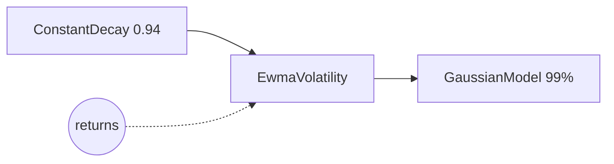

# Concepts

A few conventions run through the whole library. Knowing them makes every
model's output easy to read.

## Returns are a `TimeSeries`

Every input and output is a [`TimeSeries`][tail_lib.time_series.TimeSeries]:
an array of dates, and an array of values with **time on the first axis**.

```python
import numpy as np
from tail_lib.time_series import TimeSeries

returns = TimeSeries(
    dates=np.array(["2024-01-02", "2024-01-03", "2024-01-04"], dtype="datetime64[D]"),
    values=np.array([0.004, -0.012, 0.007]),
)
```

Building the arrays is the caller's job: the library checks what it receives
and does nothing more with it (R8).

### Many series at once

The axes after the first are independent series, the *batch*. A values array
of shape `(n_dates, 50)` holds 50 return series on the same dates, and every
model computes all 50 at once. Model outputs keep that shape: a VaR of shape
`(n_dates, 50)`.

Model parameters can differ by series: give an array that broadcasts to the
batch shape instead of a single value, e.g. one decay factor per series.

```python
ConstantDecay(np.array([0.94, 0.97]))  # returns of shape (n_dates, 2)
```

### Filling in dates

When the dates don't matter, let the library fill them in from a first or
last date (R8a). Dates follow a [`Calendar`][tail_lib.calendar.Calendar],
Monday to Friday without holidays by default.

```python
import datetime
from tail_lib.calendar import Calendar

TimeSeries.from_first_date(datetime.date(2024, 1, 1), values)
TimeSeries.to_last_date(datetime.date(2024, 12, 31), values)

# Your own valid dates: e.g. weekdays, minus some holidays.
calendar = Calendar(holidays=[datetime.date(2024, 12, 25)])
TimeSeries.to_last_date(datetime.date(2024, 12, 31), values, calendar=calendar)
```

## Timing: the value on `t` is the forecast for `t + 1`

A value on date `t` (a volatility, a decay factor, a VaR) uses data up to and
including `t`, and is the forecast for the next date, `t + 1` (D1). There is
no look-ahead.

So the VaR on Monday is the forecast for Tuesday's return, and a backtest
compares it with Tuesday's return. Each model's docstring states its timing.

## Sign: VaR is a return quantile

A VaR is a **return quantile, negative for a loss** (R14). A 99% VaR of
`-0.025` means a 1% chance of losing more than 2.5% the next day.

The return of date `t` **overshoots** the VaR when it falls below the VaR of
the day before:

\[
r_t < \mathrm{VaR}_{t-1}
\]

The library says "overshootings", never "exceedances".

Models take their confidence level as `cf`, in (0, 1), e.g. `0.99`. The VaR
is then the `1 - cf` quantile of the next return.

## Warm-up: leading `NaN`s

Most models need some history before their first value: a window to fill, a
backcast to start a recursion. Their output is `NaN` until then. A model
reading another one starts on its first value (R16): a filtered historical
simulation on 500 dates, filtered by an EWMA volatility with a 20-day
backcast, has its first window on dates 20 to 519.

## Models are nodes

Each computation is a **node**: a value-at-risk model, a model it reads (a
volatility, a mean, a decay factor), or a backtest. A node takes the nodes it
reads as constructor arguments, so a model is a small graph:

```python
decay = ConstantDecay(0.94)
vol = EwmaVolatility(decay)
model = GaussianModel(cf=0.99, vol=vol)
```



Every node also reads the returns of the run.

Two rules decide what is a node and what is a plain setting:

- **A parameter that can be estimated from the returns is a node**, e.g. a
  volatility, or a decay factor. A constant decay is then a node too
  (`ConstantDecay`), next to a calibrated one (`EwmaDecayCalibration`), so you
  can swap one for the other.
- **A parameter always set by hand is a constructor argument**, e.g. a
  confidence level, a window, the bounds of a fit.

### Sharing work

A node is computed at most once per run. Nodes are identified by value: two
nodes of the same class with the same arguments are one node, so it is
computed once for all the models that read it (D3, D9):

```python
models = {
    "gauss_99": GaussianModel(cf=0.99, vol=EwmaVolatility(ConstantDecay(0.94))),
    # An equal volatility: the same node, computed once
    "gauss_975": GaussianModel(cf=0.975, vol=EwmaVolatility(ConstantDecay(0.94))),
}
```

Nodes can't be changed once built (they are frozen dataclasses), so sharing
one is always safe. From [specs](specs.md), it works the same way: identical
specs give one node.

## Windows

Models that work on a sample of past returns, such as historical simulation,
take a window. There are two kinds:

[`Trailing(length, step=1)`][tail_lib.windows.Trailing]
:   Rolling windows of `length` dates. The first ends on date `length - 1`,
    then one ends every `step` dates. Each result belongs to its window's last
    date, and is held until the next window ends. This gives a value on every
    date, so the model can be backtested.

[`Last(length)`][tail_lib.windows.Last]
:   One window: the last `length` dates. The model gives one value, on the
    last date, e.g. today's VaR, without computing every past window. Such a
    model has nothing to backtest: its only value is the forecast for a date
    after the data.

```python
from tail_lib.windows import Last, Trailing

Trailing(length=250)  # a VaR on every date from date 249
Trailing(length=250, step=5)  # refit every 5 dates, held in between
Last(length=250)  # today's VaR only
```

## Run inputs

Data computed outside the library, e.g. VaR forecasts from another system, or
volatilities from a data service, enters a run as a **named input** (R13). An
input node declares the name, and you pass the series under that name at run
time. A missing input is an error, reported before anything is computed. See
[Runs in Python](python-runs.md#run-inputs).
