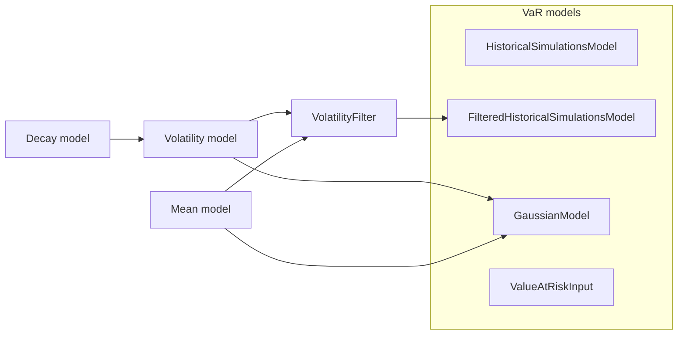

# Models

Value-at-risk models produce one VaR per date. Some read other models: a
volatility, a mean, a volatility filter. Those read decay factors in turn.
This page lists them all, with their formulas and settings.

Notation: \(r_t\) is the return of date \(t\), \(c\) the confidence level
`cf`. Every value on date \(t\) uses data up to and including \(t\), and is
the forecast for \(t + 1\) (see [timing](concepts.md#timing-the-value-on-t-is-the-forecast-for-t-1)).



## Value-at-risk models

All value-at-risk models take `cf`, their confidence level in (0, 1), and
return the VaR as a `TimeSeries` on the dates of the returns.

### Historical simulation

[`HistoricalSimulationsModel`][tail_lib.models.value_at_risk.HistoricalSimulationsModel]
takes the empirical quantile of the returns in a trailing window of `length`
dates:

\[
\mathrm{VaR}_t = Q_{1-c}\left(r_{t-\text{length}+1}, \ldots, r_t\right)
\]

| Setting | Meaning |
|---|---|
| `cf` | Confidence level, in (0, 1). |
| `window` | `Trailing(length, step)` or `Last(length)`. With `step > 1`, each VaR is held until the next window ends. |
| `interpolation` | How the quantile falls between order statistics: `"linear"` (default), `"below"` or `"above"`. |

The first VaR is on date `length - 1`. Reference: Jorion, *Value at Risk*,
3rd edition, 2007.

=== "Python"

    ```python
    HistoricalSimulationsModel(cf=0.99, window=Trailing(length=250))
    ```

=== "Spec"

    ```json
    {"type": "historical", "cf": 0.99,
     "window": {"type": "trailing", "length": 250}}
    ```

### Filtered historical simulation

[`FilteredHistoricalSimulationsModel`][tail_lib.models.value_at_risk.FilteredHistoricalSimulationsModel]
runs historical simulation on returns standardized by a
[volatility filter](#volatility-filter), then rescales the quantile with
today's mean and volatility:

\[
z_s = \frac{r_s - \mu_{s-1}}{\sigma_{s-1}}, \qquad
\mathrm{VaR}_t = \mu_t + \sigma_t \, Q_{1-c}\left(z_{t-\text{length}+1}, \ldots, z_t\right)
\]

| Setting | Meaning |
|---|---|
| `cf` | Confidence level, in (0, 1). |
| `filter` | A `VolatilityFilter`: the volatility \(\sigma\) and mean \(\mu\) that standardize the returns, and rescale the quantile. |
| `window` | `Trailing(length, step)` or `Last(length)`, over the standardized returns. |
| `interpolation` | As for historical simulation. |

The windows start on the first standardized return, after the warm-up of the
volatility: with an EWMA backcast on 20 dates, the first window of 500 dates
holds dates 20 to 519. Share one filter between models on several windows, so
it is computed once.

References: Hull and White (1998), *Journal of Risk*; Barone-Adesi,
Giannopoulos and Vosper (1999), *Journal of Futures Markets*.

=== "Python"

    ```python
    vol_filter = VolatilityFilter(EwmaVolatility(ConstantDecay(0.94)))
    FilteredHistoricalSimulationsModel(
        cf=0.99, filter=vol_filter, window=Trailing(length=500)
    )
    ```

=== "Spec"

    ```json
    {"type": "filtered_historical", "cf": 0.99,
     "filter": {"vol": {"type": "ewma",
                        "decay": {"type": "constant", "value": 0.94}}},
     "window": {"type": "trailing", "length": 500}}
    ```

### Gaussian

[`GaussianModel`][tail_lib.models.value_at_risk.GaussianModel] takes the
quantile of a normal distribution with the mean and volatility of the date:

\[
\mathrm{VaR}_t = \mu_t + \sigma_t \, \Phi^{-1}(1 - c)
\]

with \(\Phi^{-1}\) the standard normal quantile.

| Setting | Meaning |
|---|---|
| `cf` | Confidence level, in (0, 1). |
| `vol` | A [volatility model](#volatility-models). Volatilities must be positive, or `NaN` during a warm-up. |
| `mean` | A [mean model](#mean-models). Defaults to `ZeroMean()`. |

=== "Python"

    ```python
    GaussianModel(cf=0.99, vol=EwmaVolatility(ConstantDecay(0.94)))
    ```

=== "Spec"

    ```json
    {"type": "gaussian", "cf": 0.99,
     "vol": {"type": "ewma", "decay": {"type": "constant", "value": 0.94}}}
    ```

### External forecasts

[`ValueAtRiskInput`][tail_lib.models.value_at_risk.ValueAtRiskInput] reads VaR
forecasts computed elsewhere, passed to the run under `name`
([run inputs](python-runs.md#run-inputs)). Its `cf` is the level the
forecasts were computed at, which backtests read. Use it to backtest another
system's VaR next to the library's models.

=== "Python"

    ```python
    ValueAtRiskInput("var_ext", cf=0.99)
    ```

=== "Spec"

    ```json
    {"type": "input", "name": "var_ext", "cf": 0.99}
    ```

## Volatility models

A volatility model gives \(\sigma_t\), the forecast of the volatility of
\(r_{t+1}\).

### Constant volatility

[`ConstantVolatility(vol)`][tail_lib.models.volatility.ConstantVolatility]:
the same volatility on every date, a number or one per series.

=== "Python"

    ```python
    ConstantVolatility(0.01)
    ```

=== "Spec"

    ```json
    {"type": "constant", "vol": 0.01}
    ```

### EWMA volatility

[`EwmaVolatility`][tail_lib.models.volatility.EwmaVolatility] follows the
RiskMetrics recursion (J.P. Morgan/Reuters, 1996), with decay factor
\(\lambda\):

\[
\sigma^2_t = \lambda \, \sigma^2_{t-1} + (1 - \lambda) \, r_t^2
\]

| Setting | Meaning |
|---|---|
| `decay` | A decay node: a `ConstantDecay`, \(\lambda\) in [0, 1], or an `EwmaDecayCalibration`, see [decay models](#decay-models). |
| `start` | How the recursion gets its first variance: `Backcast(window=20)` (default) or `StartingVol(vol)`, see [EWMA starts](#ewma-starts). With a calibration, it has to be the calibration's `start`. |

With a constant decay, the recursion runs once, over the whole series.

=== "Python"

    ```python
    EwmaVolatility(ConstantDecay(0.94))
    EwmaVolatility(ConstantDecay(0.94), start=StartingVol(0.01))
    ```

=== "Spec"

    ```json
    {"type": "ewma", "decay": {"type": "constant", "value": 0.94}}
    ```

With a decay calibrated on trailing training windows
([`EwmaDecayCalibration`](#calibrated-decay)), the recursion is re-run over
each training window with the new decay, from `start`, then continued with
that decay until the next calibration. This is how `rugarch` and `arch`
forecast after a refit. The first volatility is on the last date of the
first training window.

=== "Python"

    ```python
    EwmaVolatility(EwmaDecayCalibration(Trailing(length=250, step=20)))
    ```

=== "Spec"

    ```json
    {"type": "ewma",
     "decay": {"type": "ewma_calibration",
               "window": {"type": "trailing", "length": 250, "step": 20}}}
    ```

### External volatilities

[`VolatilityInput(name)`][tail_lib.models.volatility.VolatilityInput] reads
volatilities passed to the run under `name`, e.g. from a data service.

=== "Python"

    ```python
    VolatilityInput("vol_svc")
    ```

=== "Spec"

    ```json
    {"type": "input", "name": "vol_svc"}
    ```

## Volatility filter

[`VolatilityFilter`][tail_lib.models.volatility.VolatilityFilter]
standardizes the returns by the mean and volatility forecast for their date:

\[
z_t = \frac{r_t - \mu_{t-1}}{\sigma_{t-1}}
\]

| Setting | Meaning |
|---|---|
| `vol` | A [volatility model](#volatility-models). |
| `mean` | A [mean model](#mean-models). Defaults to `ZeroMean()`. |

It is the `filter` of a filtered historical simulation. It outputs
[`FilteredReturns`][tail_lib.models.volatility.FilteredReturns]: the
standardized returns (`standardized`), with the mean (`mean`) and volatility
(`vol`) that standardized them, which the simulation rescales its quantiles
with. The first standardized return is `NaN`, as are those before the first
volatility.

=== "Python"

    ```python
    VolatilityFilter(EwmaVolatility(ConstantDecay(0.94)), mean=ConstantMean(0.0002))
    ```

=== "Spec"

    ```json
    {"vol": {"type": "ewma", "decay": {"type": "constant", "value": 0.94}},
     "mean": {"type": "constant", "mean": 0.0002}}
    ```

## Mean models

A mean model gives \(\mu_t\), the forecast of the mean of \(r_{t+1}\).

| Python | Spec | Mean on every date |
|---|---|---|
| [`ZeroMean()`][tail_lib.models.mean.ZeroMean] | `{"type": "zero"}` | 0 |
| [`ConstantMean(mean)`][tail_lib.models.mean.ConstantMean] | `{"type": "constant", "mean": 0.0002}` | `mean`, a number or one per series |

## Decay models

The decay factor of an EWMA is a node, so a constant decay and a calibrated
one are interchangeable inputs. A decay model outputs
[`DecayFactors`][tail_lib.models.ewma.DecayFactors]: the decay in force on
each date (`values`), the dates a new decay comes into force (`refits`), and,
for each, the first date of the returns it was fitted on (`fit_starts`). The
EWMA re-filters from there at each refit.

### Constant decay

[`ConstantDecay(value)`][tail_lib.models.ewma.ConstantDecay]: the same
decay on every date, in [0, 1], a number or one per series. It has one refit,
on the first date. It is the
`decay` of an `EwmaVolatility`.

=== "Python"

    ```python
    ConstantDecay(0.94)
    ```

=== "Spec"

    ```json
    {"type": "constant", "value": 0.94}
    ```

### Calibrated decay

[`EwmaDecayCalibration`][tail_lib.models.ewma.EwmaDecayCalibration] fits the
decay by maximum likelihood on each training window: it minimizes the
Gaussian negative log-likelihood of the zero-mean EWMA variance forecasts,

\[
\frac{1}{2} \sum_t \left( \ln \sigma^2_{t-1} + \frac{r_t^2}{\sigma^2_{t-1}} \right),
\]

with a golden-section search on `bounds`, vectorized over the series. The
decay on a date is the fit of the last window ending on or before it. It is
the `decay` of an `EwmaVolatility`, which re-filters each window with its
fit.

| Setting | Meaning |
|---|---|
| `window` | The training windows: `Trailing(length, step)`, a fit every `step` dates, or `Last(length)`, one fit. |
| `bounds` | The search interval of the decay. Default `(0.8, 0.9999)`. |
| `start` | How each fit's recursion starts. Default `Backcast(window=20)`, on the first dates of each window. |
| `n_iter` | Golden-section iterations per fit. Default `40`: the interval shrinks by about 0.618 per iteration. |

=== "Python"

    ```python
    EwmaDecayCalibration(Trailing(length=500, step=20), bounds=(0.85, 0.99))
    ```

=== "Spec"

    ```json
    {"type": "ewma_calibration",
     "window": {"type": "trailing", "length": 500, "step": 20},
     "bounds": [0.85, 0.99]}
    ```

## EWMA starts

An EWMA recursion needs a first variance. Starts are settings, not nodes.

[`Backcast(window=20)`][tail_lib.models.ewma.Backcast]
:   The variance as of date `window - 1` is the mean squared return of dates
    `0` to `window - 1`. The volatility is `NaN` before that date.

[`StartingVol(vol)`][tail_lib.models.ewma.StartingVol]
:   `vol` is the volatility forecast for date `0`. The recursion runs from
    date `0`, so there is no warm-up.

=== "Python"

    ```python
    Backcast(window=60)
    StartingVol(0.01)
    ```

=== "Spec"

    ```json
    {"type": "backcast", "window": 60}
    {"type": "starting_vol", "vol": 0.01}
    ```

## Imports

```python
from tail_lib.models.ewma import (
    Backcast,
    ConstantDecay,
    EwmaDecayCalibration,
    StartingVol,
)
from tail_lib.models.mean import ConstantMean, ZeroMean
from tail_lib.models.value_at_risk import (
    FilteredHistoricalSimulationsModel,
    GaussianModel,
    HistoricalSimulationsModel,
    ValueAtRiskInput,
)
from tail_lib.models.volatility import (
    ConstantVolatility,
    EwmaVolatility,
    VolatilityFilter,
    VolatilityInput,
)
from tail_lib.time_series import Last, Trailing
```
